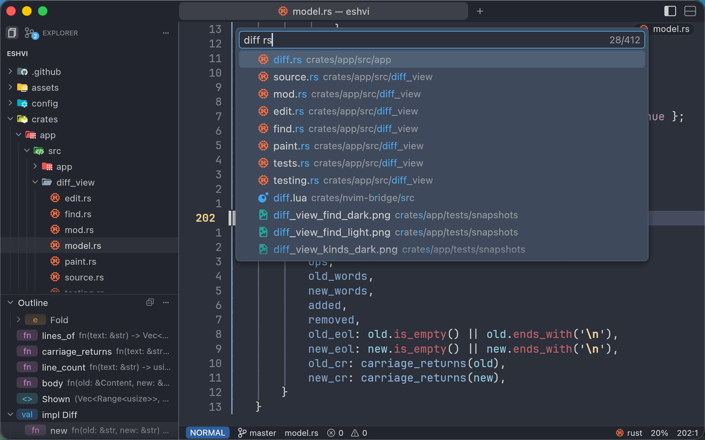
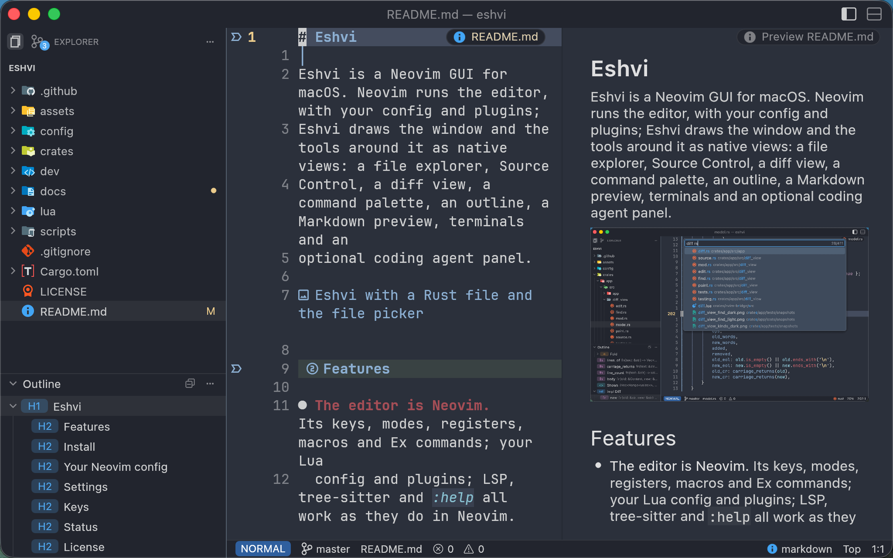
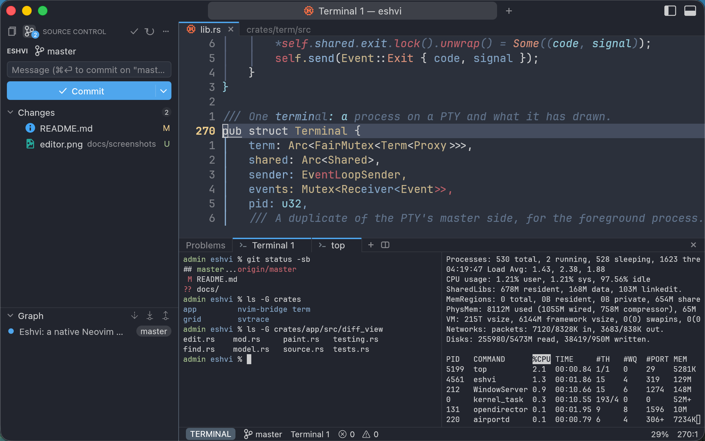
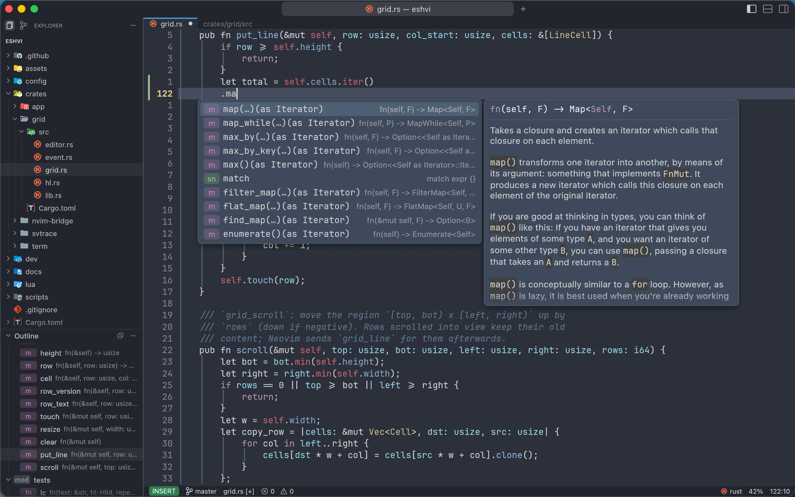

# Eshvi

Eshvi is a Neovim GUI for macOS. Neovim runs the editor, with your config and plugins;
Eshvi draws the window and the tools around it as native views: a file explorer, Source
Control, a diff view, a command palette, an outline, a Markdown preview, terminals and an
optional coding agent panel.



## Features

- **The editor is Neovim.** Its keys, modes, registers, macros and Ex commands; your Lua
  config and plugins; LSP, tree-sitter and `:help` all work as they do in Neovim.
- **Explorer**: icons, git status, nesting of related files, drag and drop, multi-select,
  file operations.
- **Source Control**: stage, commit, push and pull, branches, and a commit graph with
  diffs.
- **Diff view**: several files in one scrolling view, unified or side by side, with
  word-level changes and syntax colors. Stage, unstage or discard a single change, or
  accept or revert an agent's change.
- **Command palette and pickers**: ⌘P for files, ⇧⌘P for commands, plus grep, symbols,
  references, diagnostics, buffers and more.
- **Outline**: your file's symbols from the language server, or a Markdown file's
  headings, following the cursor.
- **Markdown preview**, in place or beside the text, with tables and images.
- **Terminals** at the bottom, with tabs and a split, built on alacritty's terminal:
  mouse selection, ⌘C/⌘V, copy on select, ⌘F search, a Vi mode and clickable file
  links. Buttons at the right of the tab strip show a **Problems** list of your
  diagnostics and the **Git output**.
- **⌃h/j/k/l moves between everything**: Neovim's windows, the side bar, the terminals and
  the agent panel.
- **Sessions**: each folder's windows and panels come back when you open it again, and
  you can save named ones.
- **Agent panel** (off unless you turn it on) for Claude Code or another coding agent.
  Its changes open in the diff view for review.
- **Native popups** for completion, hover, signature help and diagnostics, a status bar,
  tabs, a macOS menu bar, smooth scrolling and font ligatures.
- **SystemVerilog design hierarchy and signal trace** with
  [slang-server](https://github.com/hudson-trading/slang-server), as side bar views.
- **`:checkhealth eshvi`** tells you which plugins still draw their own popups, so you
  can replace them with native ones.







## Install

Eshvi runs on macOS 11 or later. Linux and Windows are coming.

You need [Neovim](https://neovim.io) 0.12 or later on your `PATH`
(`brew install neovim`).

**Download** `eshvi-macos-arm64.zip` from [Releases](https://github.com/aviyn/eshvi/releases)
(Apple silicon), unzip it and move `Eshvi.app` to `/Applications`.

**Or build it** from source with [Rust](https://rustup.rs) 1.85 or later (Intel Macs too):

```sh
git clone https://github.com/aviyn/eshvi
cd eshvi
cargo build --release
scripts/bundle-macos.sh        # makes target/release/Eshvi.app
```

Then move `target/release/Eshvi.app` to `/Applications`.

The app isn't notarized yet:
the first time, open it from Finder with right-click › Open, or allow it in System
Settings › Privacy & Security.

You can also run it straight from the build: `target/release/eshvi [file…]`.

## Your Neovim config

Eshvi keeps its own Neovim config, separate from your terminal Neovim, in
`~/.config/eshvi/nvim`. That's where the native completion menu, status bar and pickers
are switched on. To start:

- **Bring your own config.** Copy it in:
  `mkdir -p ~/.config/eshvi && cp -RL ~/.config/nvim ~/.config/eshvi/nvim`.
  Eshvi's completion, status bar and picker replace plugins like nvim-cmp, lualine and
  Telescope; `:checkhealth eshvi` lists what to remove.
- **Or use the included one**: `config/nvim` in this repo, a lazy.nvim setup made for Eshvi:
  `mkdir -p ~/.config/eshvi && ln -s "$PWD/config/nvim" ~/.config/eshvi/nvim`.
- **Or share your terminal config as it is**, with `config = "shared"` under `[neovim]`
  in `~/.config/eshvi/config.toml`. The panels all work; completion, the status bar and
  pickers stay your plugins'.

With no config there, Eshvi is plain Neovim with its native features on.

## Settings

`~/.config/eshvi/config.toml`, opened by Eshvi › Settings… (⌘,). Every key is optional and most
apply while it runs: fonts, the explorer, the panels, popups, colors. Neovim's own settings stay
in your Neovim config.

[`config/config.example.toml`](config/config.example.toml) lists every setting with its default
and what else it takes. Copy it as a starting point:

```sh
mkdir -p ~/.config/eshvi && cp config/config.example.toml ~/.config/eshvi/config.toml
```

A few you may want first:

```toml
font = "JetBrains_Mono:h14"   # or set 'guifont' in your Neovim config

[agent]
enabled = true                # the agent panel (⌥⌘B); Claude Code by default
command = ["claude"]

[terminal]
shell = "/opt/homebrew/bin/bash"   # default: your $SHELL
```

## Keys

Neovim's keys are all yours. Eshvi adds the Mac ones around them:

| | |
|---|---|
| ⌘P / ⇧⌘P | files / commands |
| ⌘B, ⇧⌘E | explorer: show or hide, focus |
| ⌃⇧G | Source Control |
| ⌘J | bottom panel (the terminals) |
| ⌃\` | terminal |
| ⇧⌘M | Problems |
| ⇧⌘U | Git output |
| ⌥⌘B | agent panel |
| ⌃h ⌃j ⌃k ⌃l | move between windows and panels |
| ⌘= / ⌘− | zoom |
| ⌘, | settings |

## Status

Eshvi is young. Expect rough edges, and please report
them.

## License

MIT. Icons: [Material Icon Theme](https://github.com/material-extensions/vscode-material-icon-theme)
and [Codicons](https://github.com/microsoft/vscode-codicons). SystemVerilog grammar:
[TheClams/SystemVerilog](https://github.com/TheClams/SystemVerilog), Apache-2.0. See `assets/`.
